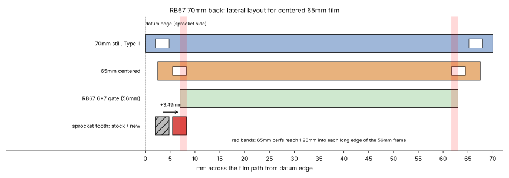

# Centered 65mm film in a Mamiya RB67 70mm back

Goal: shoot 65mm motion-picture negative (Kodak Vision3 etc.) in a Mamiya
RB67 "70mm Film Holder" with the film **centered** on the gate and the
back's original sprocket-driven frame counting and advance lock **still
working**. Existing community mods don't do both (see below).

## How the RB67 70mm back works (relevant parts)

- Made 1975 to 2008: a Pro-S generation back that Mamiya also sold
  alongside the Pro-SD line. Slightly larger than a 120 Pro-S back. 6x7
  gate. Uses standard daylight-load 70mm metal cassettes for feed and
  take-up. It also has an optional vacuum port that pulls the film flat
  against the back plate. The Rollei 6000 Magazin 70 is a re-engineered
  version of this same back.
- **Frame metering is done by a single sprocket wheel** at one end of the
  feed roller shaft, next to the carriage side wall. Type II perforations
  (KS-shaped, 4.75mm pitch) turn it, and it drives both the frame counter
  and the advance lock. With unperforated film, or thin aerial stock that
  slips on the sprocket, the back mis-spaces frames or won't lock.
- Access: lift the film carriage out of the shell and take off the
  carriage bottom. A small retaining plate (two small Phillips screws) holds
  a white plastic guide roller. Remove the plate and roller and the sprocket
  wheel is exposed on the end of the roller shaft.

## Existing approaches

| Approach | Film position | Metering | Notes |
|---|---|---|---|
| Stock back | 70mm Type II only | sprocket | 65mm teeth land on solid film |
| Mercury "all-perf" mod | 65mm on **offset** spools | friction: teeth ground off, ¼" orthodontic elastic in the groove | Irreversible, the band can slip off, and the film is off center |
| Mercury custom RB 65/70 back | centered | lever stroke to printed lines on the back (counter bypassed) | Sold out, and you have to judge spacing by eye |
| Pentax 645 65mm mod | max offset | trim outer ⅓ of the stock teeth | Works only because flush 65mm perfs partly overlap Type II perfs. Image loses 3.8mm |
| **This design** | **centered** | **new sprocket, teeth moved inboard** | Reversible: swap the original wheel back in |

One inconsistency to note: Mercury's spool page says "Centered" spools suit
"Mamiya 70mm backs", but their compatibility table lists the stock RB 70mm
holder (after the all-perf mod) with **Offset** spools. Offset spools are
what make the 65mm film reach the elastic band on the stock-position wheel.

## The numbers (run `python3 film_geometry.py`)

| | value | source |
|---|---|---|
| 65mm width | 64.97 mm | SMPTE ST 145 |
| 65mm edge → perforation | 2.97 mm | SMPTE ST 145 |
| perforation (across × along) | 2.794 × 1.981 mm | ST 145 / ST 119 |
| pitch KS-1870 / KS-1866 | 4.750 / 4.740 mm | ST 145 |
| 70mm print (perf 65mm) edge → perf | 5.46 mm | SMPTE ST 119 |
| 70mm Type II edge → perf | ~2.0 mm | **approximate**: DoD doc (0.079in) and the Pentax mod geometry agree |
| 65mm centered: edge offset | 2.52 mm | derived |
| **sprocket tooth shift inboard** | **3.49 mm** | derived (≈ ST 119 margin − Type II margin) |
| clear width between 65mm perf rows | 53.44 mm | derived |
| perf intrusion into the 56mm frame | 1.28 mm per long edge | derived |

The perforation size and pitch are the same as Type II. So the new sprocket
keeps the stock tooth count and pitch diameter, and the counter and lock
gearing still turn the same amount per frame. Only the axial position of
the tooth ring changes. Most camera negative uses the KS-1866 short pitch,
which is 0.21% shorter than Type II. That is about 0.15mm over a frame and
gets absorbed by tooth clearance.

**Frame-edge perforations:** a full 56mm frame centered on 65mm film
overlaps the perforation rows by about 1.3mm on each long edge, so perfs
will show in the image. You can crop to ~53.4mm, or accept it (it looks
like an IMAX frame). You can't fix this by moving the film.

## Parts (`rb67_65mm.py`, CadQuery)

1. **`offset_sprocket`**: replacement wheel for the roller shaft. Same
   bore, same wall-side face, but the hub extends ~3.5mm inboard and carries
   the tooth ring there. D-flat bore plus an M1.6 set screw. Print it in
   resin to check fit. For real use, machine it in brass or aluminium, or
   have it SLS/MJF printed. Teeth this small (≈2.4 × 1.6 × 0.9mm) need
   resin or machining.
2. **`spool_spacer`**: a 2.6mm C-ring that snaps onto the core of a stock
   70mm spool against each flange. It turns a 70mm spool into a centered
   65mm spool. You need 4 per load.

`python3 rb67_65mm.py` writes STEP and STL files to `out/`, which is not
committed. `python3 render_layout.py` regenerates `layout.svg`.

## Measurement checklist (everything tagged MEASURE in the code)

Nothing about the RB67 back's internals is published (no service manual
turned up). Before making any part, measure the following:

- [ ] Sprocket: tooth count, outer and root diameter, axial width, axial
      position of the tooth centerline relative to the wall-side face.
- [ ] How the sprocket is fixed to the shaft: pressed, pinned, D-flat or
      set screw. Also whether it comes off without disturbing the
      counter/lock linkage.
- [ ] Shaft diameter and any flat.
- [ ] Free axial length of bare shaft inboard of the sprocket. The new hub
      needs ~7.2mm against the stock ~3mm.
- [ ] Position of the sprocket teeth relative to the gate's film edge rails.
      This confirms the datum, i.e. that the Type II perf center sits ~3.4mm
      from the edge.
- [ ] Clearance under the white guide roller and retaining plate. The plate
      may need relieving where the new hub passes.
- [ ] 70mm spool: core diameter, face-to-face flange gap, flange diameter,
      and any tape slot.
- [ ] Type II film strip: edge → perforation, to replace the 2.0mm estimate.
- [ ] Whether the far end of the roller has a matching disc, and whether
      65mm film still rides on it when centered.

Photos of the sprocket with a caliper next to it would be enough to firm up
most of these.

## Risks / open questions

- The guide rollers and gate rails may not keep 65mm film from wandering
  sideways. A positively engaged sprocket gives some lateral registration,
  but you might also need edge-guide collars on the rollers.
- The wrap angle on the sprocket is unknown. If only 1 or 2 teeth engage,
  the film could ride up. Check how far the film wraps around the roller.
- 65mm Vision3 has rem-jet backing. Check that it doesn't shed in the back
  or gum up the teeth.
- Fallback: Mercury's "lever stroke to a printed line" bypass of the
  counter/lock works with any film and can coexist with this design.

## Sources

- Zach Horton / Mercury Works, [RB67 all-perf mod](https://www.shoot70mm.zachhorton.com/RB67_all-perf_mod.html) and [Cameras & Backs](https://www.shoot70mm.zachhorton.com/cameras_backs.html)
- shoot70mm.com, [65mm Film](https://shoot70mm.com/65mm_film.html) (compatibility table, Pentax 645 and Linhof mod PDFs)
- Mercury Works, [65mm cassette spool set](https://mercuryworks.store/products/65mm-cassette-spool-set)
- SMPTE [ST 145:2004](https://pub.smpte.org/pub/st145/st0145-2004_stable2015.pdf) (65mm KS) and [ST 119:2011](https://pub.smpte.org/doc/st119/20111003-pub/st0119-2011.pdf) (70mm perforated 65mm)
- Type II margin hint: [DoD Optical Systems Group doc 451-00](https://www.trmc.osd.mil/wiki/download/attachments/113019925/451-00.pdf?api=v2) (seen via a search excerpt only)
